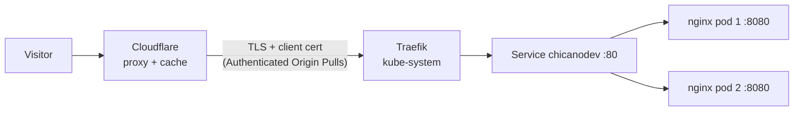
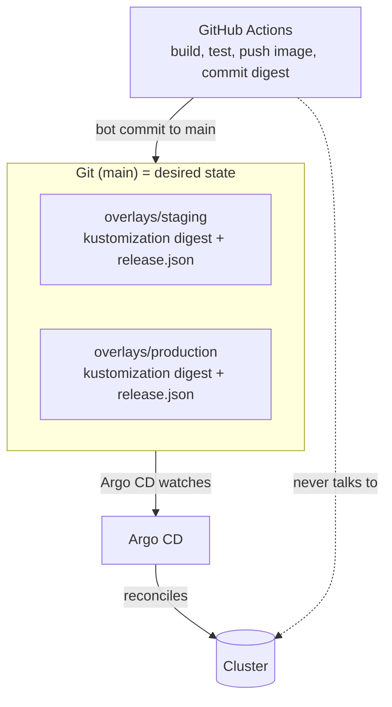
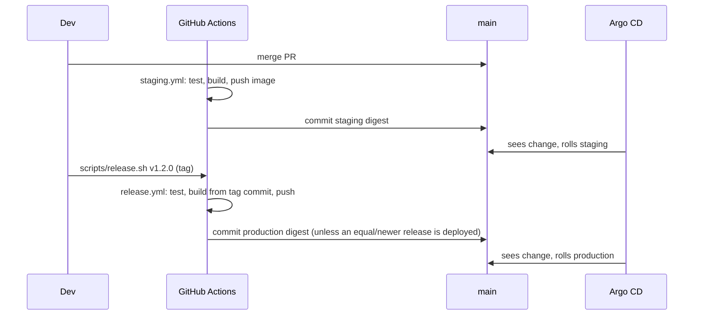
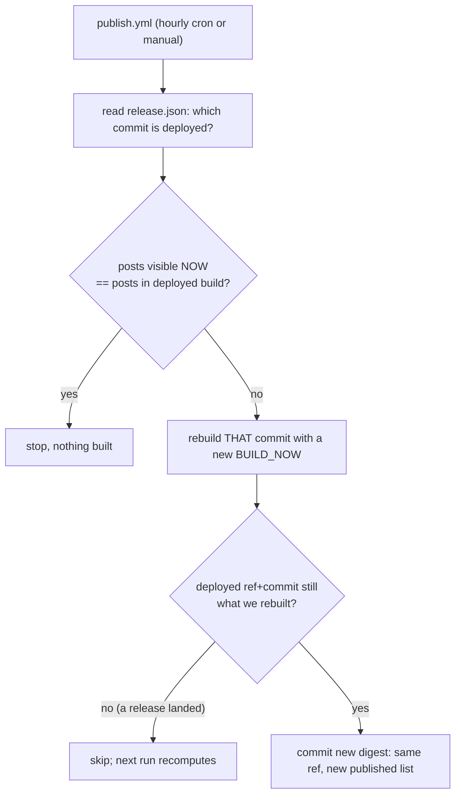

# Architecture

ChicanoDev is a statically generated Astro site. It stays static: no server-side
rendering, no database, no persistent volumes, no Node.js in production. The only
thing that changed is where the compiled files are served from.

## Request path

Two replicas on different nodes when possible, a PodDisruptionBudget of 1, rolling
updates with `maxUnavailable: 0`. Pods run as uid 101 with a read-only root
filesystem; only `/tmp` is writable (an `emptyDir`).

## Who decides what

CI builds and writes a digest into Git. **Argo CD is the only thing that changes
the cluster.** A green workflow means "the desired state was updated", not "the site
is healthy"; Argo's Synced/Healthy status and `/version.json` answer that.

## Release model

| | Staging | Production |
|---|---|---|
| Source | latest successful build of `main` | latest `vX.Y.Z` tag (on `main`) |
| Trigger | push to `main` (`staging.yml`) | tag push (`release.yml`) |
| Host | `staging.chicanodev.com` (basic auth, noindex) | `chicanodev.com` (+ `www` redirect) |
| Image | `@sha256` digest in `overlays/staging` | `@sha256` digest in `overlays/production` |

Manifests (probes, resources, ingress) follow `main` for both environments through
Argo; a release gates the **application image**, not cluster configuration.

## Scheduled publishing

A static site cannot show "a post as of now": the set of posts is fixed at build
time. `getPosts()` hides drafts and any post whose `date` (a real instant, offset
included) is after the build's `BUILD_NOW`. So a post "publishes" when something
rebuilds the site after its date.

- **A content rebuild is not a release.** It rebuilds the already-released source,
  so unreleased commits on `main` never reach production through the schedule.
- **Missed runs self-heal.** Each run compares the clock to the deployed build,
  not "since the last run".
- **Retries are idempotent.** Same inputs, same decision; a failed deploy is fixed
  by re-running the workflow.
- **Out-of-order workflows cannot win.** `scripts/deploy-state.mjs` refuses an older
  release, a content rebuild of a superseded source, and an older staging commit.
  `promote.sh` re-reads fresh `main` on every attempt and retries a rejected push.
- **Prediction is checked.** CI predicts the post list from front matter, then
  verifies the built image contains exactly that list; a mismatch fails the build
  (otherwise scheduled rebuilds could loop).
- Expected delay: up to the cron interval (hourly, and GitHub may start it late)
  plus ~5 minutes of build. HTML/RSS/sitemaps are sent with
  `max-age=0, must-revalidate`, so Cloudflare does not hold old pages and no
  purge is required.

## Container

`Dockerfile`: a Node 24.14.1 build stage (pinned by digest, same as `.node-version`)
compiles the site; only `dist/` is copied into `nginxinc/nginx-unprivileged` (pinned
by digest). `/healthz` for probes, `/version.json` for provenance.
`npm run test:container` runs the image the way the Deployment does.

## GitHub Pages fallback

`deploy.yml` still publishes `main` to GitHub Pages, now with an hourly gate so
scheduled posts reach the fallback too. It is untouched by the cluster work and is
not disabled by anything here.
